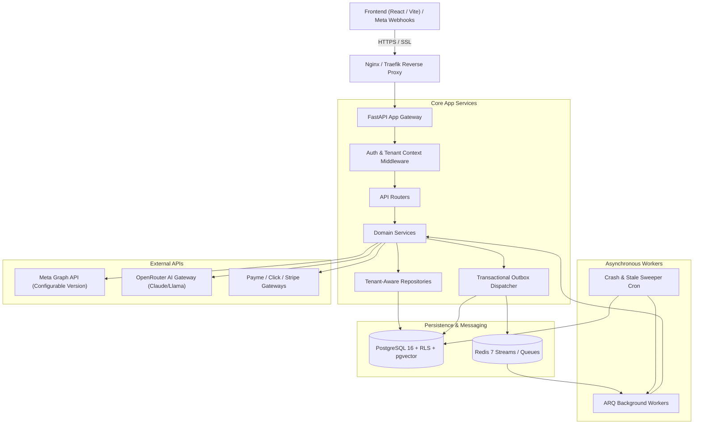

# Independent Instagram AI Automation SaaS — To‘liq Texnik Arxitektura va Tizim Loyihasi (v2.5 Master Specification)

**Hujjat versiyasi:** 2.5.0 (Unified Master Architecture Specification)  
**Status:** Audit qilingan, noaniqliklar va chegaralar ochiq belgilangan texnik loyiha  
**Hujjat vazifasi:** Ushbu spetsifikatsiya platformaning to‘liq mahsulot ko‘lami (backend, frontend, DDL, integratsiyalar) bilan bir qatorda v2.1–v2.4 auditlarida aniqlangan barcha xavfsizlik, tranzaksion yaxlitlik va chekka holatlarni yagona mukammal hujjatda birlashtiradi.

---

## 1. Tizim Umumiy Ko‘rinishi va Arxitektura Tamoyillari

Loyiha **Modular Monolith** tamoyili asosida quriladi. Dasturiy ta'minot mustaqil domen modullariga ajratilgan bo‘lib, kelajakda kerakli qismlarni mikroxizmatlarga oson ajratish imkonini beradi.

### Asosiy Tamoyillar:
1. **Separation of Concerns:** Router -> Service -> Repository -> Database qatlamlari qat'iy ajratilgan.
2. **Defense-in-Depth Multi-Tenancy:** Ilova qatlamida kontekst tekshiruvi, DB qatlamida Composite Foreign Keys va Row-Level Security (RLS).
3. **Reliable Webhook Ingestion:** Inbound hodisalar xotiraga emas, avval PostgreSQL `webhook_events` jadvaliga yoziladi.
4. **Resilient Outbound Dispatching:** Tashqi API larga xabarlar Transactional Outbox (`outbox_events`) orqali yuboriladi.
5. **No Blind Retries:** Meta API da noaniq javob (timeout) bo‘lsa, xabarlar ko‘r-ko‘rona qayta yuborilmaydi (Spam va bloklanishning oldini olish).



---

## 2. To‘liq Papkalar Tuzilishi

### 2.1 Backend Papkalar Tuzilishi (`app/`)
```
instagram_ai_saas/
├── app/
│   ├── main.py                     # FastAPI app, CORS, middlewarelar
│   ├── config/
│   │   ├── settings.py             # Pydantic BaseSettings (.env boshqaruvi)
│   │   └── logging.py              # Structlog / JSON logging
│   ├── database/
│   │   ├── connection.py           # AsyncEngine yaratish
│   │   ├── session.py              # sessionmaker va tenant context contextmanager
│   │   └── base.py                 # DeclarativeBase va umumiy modellar
│   ├── security/
│   │   ├── encryption.py           # AES-256-GCM token shifrlash
│   │   ├── jwt.py                  # Access va Refresh token yaratish
│   │   ├── password.py             # Argon2id heshlash
│   │   └── tenant_context.py       # ContextVar orqali tenant context
│   ├── models/                     # SQLAlchemy 2.0 Async ORM modellari
│   │   ├── user.py, tenant.py, subscription.py
│   │   ├── instagram.py, conversation.py, message.py
│   │   ├── lead.py, flow.py, comment.py, ai_config.py
│   │   ├── webhook.py, outbox.py, payment.py
│   ├── schemas/                    # Pydantic v2 DTOlar
│   │   ├── auth.py, tenant.py, instagram.py, message.py
│   │   ├── lead.py, flow.py, ai.py, billing.py
│   ├── repositories/               # Ma'lumotlar bazasi bilan ishlash
│   │   ├── base.py                 # Tenant scoped BaseRepository
│   │   ├── user_repo.py, tenant_repo.py, instagram_repo.py
│   │   ├── conversation_repo.py, message_repo.py, lead_repo.py
│   │   ├── flow_repo.py, outbox_repo.py, webhook_repo.py
│   ├── services/                   # Asosiy biznes logika
│   │   ├── auth_service.py, tenant_service.py, instagram_service.py
│   │   ├── webhook_normalizer.py, messaging_service.py, comment_service.py
│   │   ├── flow_engine.py, ai_service.py, entitlement_service.py
│   │   ├── payment_service.py, reconciliation_service.py
│   ├── integrations/               # Tashqi API mijozlari
│   │   ├── meta/                   # OAuth, Graph API client, error classifier
│   │   ├── ai/                     # OpenRouter async client
│   │   └── payment/                # Payme, Click, Stripe adapterlari
│   ├── workers/                    # ARQ fon vazifalari
│   │   ├── tasks.py                # Webhook, outbox, AI vazifalari
│   │   ├── sweeper.py              # Stale crash sweeper va DLQ recovery
│   │   └── scheduler.py            # Cron va token yangilash vazifalari
│   └── api/
│       ├── dependencies.py         # DB session, Current User, Current Tenant
│       └── routers/                # RESTful endpointlar
│           ├── auth.py, tenants.py, instagram.py, webhooks.py
│           ├── inbox.py, automations.py, leads.py, ai.py, billing.py
├── migrations/                     # Alembic migratsiyalari
├── tests/                          # Unit, Integration, RLS, Concurrency testlar
├── Dockerfile, docker-compose.yml, requirements.txt, .env.example
```

### 2.2 Frontend Papkalar Tuzilishi (`frontend/`)
```
frontend/
├── src/
│   ├── components/                 # UI komponentlar (Shadcn UI / Tailwind)
│   ├── features/                   # Modulli feature arxitekturasi
│   │   ├── auth/                   # Login, Register
│   │   ├── dashboard/              # Metrikalar va umumiy statistika
│   │   ├── instagram/              # Akkaunt ulash va OAuth modal
│   │   ├── inbox/                  # Live Chat va kontaktlar profili
│   │   ├── automations/            # Flow Builder (React Flow visual DAG canvas)
│   │   ├── leads/                  # CRM jadvali, teglar va eksport
│   │   ├── ai-settings/            # Prompt, bilimlar bazasi va model tanlash
│   │   └── billing/                # Tariflar, to'lovlar va usage metering
│   ├── services/                   # Typed Axios API layer
│   ├── store/                      # Zustand storelari (authStore, chatStore)
│   ├── types/                      # TypeScript interfeyslari
│   ├── App.tsx, main.tsx
```

---

## 3. PostgreSQL Ma'lumotlar Bazasi Sxemasi (To‘liq DDL va Aloqalar)

### 3.1 Moliyaviy va Audit Yaxlitligi (`ON DELETE` Qoidalari)
Tasodifiy kaskadli o‘chirishlar natijasida qimmatli audit, muloqot va to‘lov ma'lumotlari yo‘qolmasligi uchun:
- `instagram_accounts` o‘chirilganda `comment_logs`, `conversations`, `leads` o‘chirilmaydi (**`ON DELETE RESTRICT`**).
- `subscriptions` o‘chirilganda unga tegishli `payment_transactions` o‘chirilmaydi (**`ON DELETE RESTRICT`**).
- Faqat vaqtinchalik yoki tobe bog‘lamalar (masalan, `lead_tag_mappings`) `CASCADE` bo‘lishi mumkin.

### 3.2 To‘liq DDL Sxemasi

```sql
CREATE EXTENSION IF NOT EXISTS "uuid-ossp";
CREATE EXTENSION IF NOT EXISTS "pgcrypto";
CREATE EXTENSION IF NOT EXISTS "vector";

-- ============================================================================
-- 1. ASOSIY TENANT VA FOYDALANUVCHILAR
-- ============================================================================
CREATE TABLE tenants (
    id UUID PRIMARY KEY DEFAULT gen_random_uuid(),
    name VARCHAR(255) NOT NULL,
    slug VARCHAR(100) UNIQUE NOT NULL,
    is_active BOOLEAN NOT NULL DEFAULT TRUE,
    settings JSONB NOT NULL DEFAULT '{}',
    created_at TIMESTAMPTZ NOT NULL DEFAULT CURRENT_TIMESTAMP,
    updated_at TIMESTAMPTZ NOT NULL DEFAULT CURRENT_TIMESTAMP
);

CREATE TABLE users (
    id UUID PRIMARY KEY DEFAULT gen_random_uuid(),
    email VARCHAR(255) UNIQUE NOT NULL,
    hashed_password VARCHAR(255) NOT NULL,
    full_name VARCHAR(255),
    is_superadmin BOOLEAN NOT NULL DEFAULT FALSE,
    is_active BOOLEAN NOT NULL DEFAULT TRUE,
    created_at TIMESTAMPTZ NOT NULL DEFAULT CURRENT_TIMESTAMP,
    updated_at TIMESTAMPTZ NOT NULL DEFAULT CURRENT_TIMESTAMP
);

CREATE TABLE tenant_memberships (
    id UUID PRIMARY KEY DEFAULT gen_random_uuid(),
    tenant_id UUID NOT NULL REFERENCES tenants(id) ON DELETE CASCADE,
    user_id UUID NOT NULL REFERENCES users(id) ON DELETE CASCADE,
    role VARCHAR(50) NOT NULL DEFAULT 'member', -- 'owner', 'admin', 'member'
    created_at TIMESTAMPTZ NOT NULL DEFAULT CURRENT_TIMESTAMP,
    CONSTRAINT uq_tenant_membership UNIQUE (tenant_id, user_id)
);

-- ============================================================================
-- 2. TARIFLAR, OBUNA VA TO'LOVLAR
-- ============================================================================
CREATE TABLE plans (
    id UUID PRIMARY KEY DEFAULT gen_random_uuid(),
    code VARCHAR(50) UNIQUE NOT NULL, -- 'free', 'starter', 'pro', 'enterprise'
    name VARCHAR(100) NOT NULL,
    price_cents INT NOT NULL DEFAULT 0,
    currency VARCHAR(10) NOT NULL DEFAULT 'USD',
    max_instagram_accounts INT NOT NULL DEFAULT 1,
    max_monthly_messages INT NOT NULL DEFAULT 1000,
    max_ai_tokens INT NOT NULL DEFAULT 100000,
    max_flows INT NOT NULL DEFAULT 3,
    ai_features_enabled BOOLEAN NOT NULL DEFAULT FALSE,
    is_active BOOLEAN NOT NULL DEFAULT TRUE,
    created_at TIMESTAMPTZ NOT NULL DEFAULT CURRENT_TIMESTAMP
);

CREATE TABLE subscriptions (
    id UUID PRIMARY KEY DEFAULT gen_random_uuid(),
    tenant_id UUID NOT NULL REFERENCES tenants(id) ON DELETE CASCADE,
    plan_id UUID NOT NULL REFERENCES plans(id) ON DELETE RESTRICT,
    status VARCHAR(50) NOT NULL DEFAULT 'active', -- 'trialing', 'active', 'past_due', 'canceled', 'expired'
    billing_cycle VARCHAR(20) NOT NULL DEFAULT 'monthly',
    currency VARCHAR(10) NOT NULL DEFAULT 'USD',
    current_period_start TIMESTAMPTZ NOT NULL,
    current_period_end TIMESTAMPTZ NOT NULL,
    cancel_at_period_end BOOLEAN NOT NULL DEFAULT FALSE,
    canceled_at TIMESTAMPTZ,
    created_at TIMESTAMPTZ NOT NULL DEFAULT CURRENT_TIMESTAMP,
    updated_at TIMESTAMPTZ NOT NULL DEFAULT CURRENT_TIMESTAMP,
    CONSTRAINT uq_subscriptions_tenant_id_composite UNIQUE (tenant_id, id)
);
CREATE UNIQUE INDEX uq_tenant_single_active_subscription ON subscriptions (tenant_id)
    WHERE status IN ('trialing', 'active', 'past_due');

CREATE TABLE payment_transactions (
    id UUID PRIMARY KEY DEFAULT gen_random_uuid(),
    tenant_id UUID NOT NULL,
    subscription_id UUID NOT NULL,
    provider VARCHAR(50) NOT NULL, -- 'payme', 'click', 'stripe'
    provider_transaction_id VARCHAR(255) NOT NULL,
    provider_action VARCHAR(50) NOT NULL DEFAULT 'payment',
    amount_minor_units BIGINT NOT NULL, -- Tiyin yoki Sent
    currency VARCHAR(10) NOT NULL, -- 'USD', 'UZS'
    status VARCHAR(50) NOT NULL DEFAULT 'pending', -- 'pending', 'paid', 'canceled', 'failed'
    idempotency_key VARCHAR(255) NOT NULL,
    raw_callback_payload JSONB,
    created_at TIMESTAMPTZ NOT NULL DEFAULT CURRENT_TIMESTAMP,
    updated_at TIMESTAMPTZ NOT NULL DEFAULT CURRENT_TIMESTAMP,
    CONSTRAINT fk_payment_subscription FOREIGN KEY (tenant_id, subscription_id)
        REFERENCES subscriptions(tenant_id, id) ON DELETE RESTRICT,
    CONSTRAINT uq_payment_provider_tx_action UNIQUE (provider, provider_transaction_id, provider_action),
    CONSTRAINT uq_payment_provider_idempotency UNIQUE (provider, idempotency_key),
    CONSTRAINT uq_payment_transactions_composite UNIQUE (tenant_id, id),
    CONSTRAINT chk_positive_amount CHECK (amount_minor_units > 0)
);

CREATE TABLE subscription_usage_records (
    id UUID PRIMARY KEY DEFAULT gen_random_uuid(),
    tenant_id UUID NOT NULL REFERENCES tenants(id) ON DELETE CASCADE,
    period_start TIMESTAMPTZ NOT NULL,
    period_end TIMESTAMPTZ NOT NULL,
    metric VARCHAR(50) NOT NULL, -- 'messages_sent', 'ai_tokens_consumed', 'flow_executions'
    quantity INT NOT NULL DEFAULT 0,
    created_at TIMESTAMPTZ NOT NULL DEFAULT CURRENT_TIMESTAMP,
    updated_at TIMESTAMPTZ NOT NULL DEFAULT CURRENT_TIMESTAMP,
    CONSTRAINT uq_tenant_usage_metric_period UNIQUE (tenant_id, metric, period_start)
);

-- ============================================================================
-- 3. WEBHOOK INBOX VA TRANSACTIONAL OUTBOX
-- ============================================================================
CREATE TABLE webhook_events (
    id UUID PRIMARY KEY DEFAULT gen_random_uuid(),
    tenant_id UUID REFERENCES tenants(id) ON DELETE SET NULL,
    source VARCHAR(50) NOT NULL DEFAULT 'meta',
    event_id VARCHAR(255) NOT NULL,
    payload JSONB NOT NULL,
    status VARCHAR(50) NOT NULL DEFAULT 'received', -- 'received', 'processing', 'processed', 'failed', 'dlq'
    retry_count INT NOT NULL DEFAULT 0,
    max_retries INT NOT NULL DEFAULT 5,
    next_retry_at TIMESTAMPTZ NOT NULL DEFAULT CURRENT_TIMESTAMP,
    lease_version INT NOT NULL DEFAULT 1,
    locked_at TIMESTAMPTZ,
    locked_by VARCHAR(100),
    error_message TEXT,
    received_at TIMESTAMPTZ NOT NULL DEFAULT CURRENT_TIMESTAMP,
    processed_at TIMESTAMPTZ,
    CONSTRAINT uq_webhook_source_event UNIQUE (source, event_id)
);
CREATE INDEX idx_webhook_events_queue ON webhook_events(source, status, next_retry_at)
    WHERE status IN ('received', 'processing', 'failed');

CREATE TABLE outbox_events (
    id UUID PRIMARY KEY DEFAULT gen_random_uuid(),
    tenant_id UUID NOT NULL REFERENCES tenants(id) ON DELETE CASCADE,
    destination VARCHAR(50) NOT NULL, -- 'meta_send_api', 'meta_comment_reply'
    event_type VARCHAR(100) NOT NULL,
    idempotency_key VARCHAR(255) NOT NULL,
    payload JSONB NOT NULL,
    status VARCHAR(50) NOT NULL DEFAULT 'pending',
    -- 'pending', 'sending', 'accepted_by_meta', 'delivered', 'read', 'rejected_transient', 'rejected_permanent', 'unknown', 'unresolved'
    retry_count INT NOT NULL DEFAULT 0,
    max_retries INT NOT NULL DEFAULT 5,
    next_retry_at TIMESTAMPTZ NOT NULL DEFAULT CURRENT_TIMESTAMP,
    locked_at TIMESTAMPTZ,
    locked_by VARCHAR(100),
    error_message TEXT,
    created_at TIMESTAMPTZ NOT NULL DEFAULT CURRENT_TIMESTAMP,
    sent_at TIMESTAMPTZ,
    CONSTRAINT uq_outbox_tenant_idempotency UNIQUE (tenant_id, idempotency_key),
    CONSTRAINT uq_outbox_events_composite UNIQUE (tenant_id, id)
);

-- ============================================================================
-- 4. INSTAGRAM AKKAUNTLARI VA SUHBATLAR
-- ============================================================================
CREATE TABLE instagram_accounts (
    id UUID PRIMARY KEY DEFAULT gen_random_uuid(),
    tenant_id UUID NOT NULL REFERENCES tenants(id) ON DELETE CASCADE,
    ig_user_id VARCHAR(100) NOT NULL,
    page_id VARCHAR(100) NOT NULL,
    username VARCHAR(255) NOT NULL,
    name VARCHAR(255),
    profile_picture_url TEXT,
    encrypted_access_token TEXT NOT NULL, -- AES-256-GCM
    token_expires_at TIMESTAMPTZ NOT NULL,
    webhook_subscribed BOOLEAN NOT NULL DEFAULT FALSE,
    is_active BOOLEAN NOT NULL DEFAULT TRUE,
    deleted_at TIMESTAMPTZ, -- Soft-delete
    created_at TIMESTAMPTZ NOT NULL DEFAULT CURRENT_TIMESTAMP,
    updated_at TIMESTAMPTZ NOT NULL DEFAULT CURRENT_TIMESTAMP,
    CONSTRAINT uq_tenant_ig_account UNIQUE (tenant_id, ig_user_id),
    CONSTRAINT uq_instagram_accounts_composite UNIQUE (tenant_id, id)
);

CREATE TABLE conversations (
    id UUID PRIMARY KEY DEFAULT gen_random_uuid(),
    tenant_id UUID NOT NULL,
    instagram_account_id UUID NOT NULL,
    ig_recipient_id VARCHAR(100) NOT NULL,
    recipient_username VARCHAR(255),
    status VARCHAR(50) NOT NULL DEFAULT 'open', -- 'open', 'resolved', 'pending'
    mode VARCHAR(50) NOT NULL DEFAULT 'bot',    -- 'bot', 'human_takeover', 'ai_assistant'
    last_message_at TIMESTAMPTZ NOT NULL DEFAULT CURRENT_TIMESTAMP,
    messaging_window_expires_at TIMESTAMPTZ NOT NULL, -- 24h limit
    unread_count INT NOT NULL DEFAULT 0,
    created_at TIMESTAMPTZ NOT NULL DEFAULT CURRENT_TIMESTAMP,
    updated_at TIMESTAMPTZ NOT NULL DEFAULT CURRENT_TIMESTAMP,
    CONSTRAINT fk_conversations_account FOREIGN KEY (tenant_id, instagram_account_id)
        REFERENCES instagram_accounts(tenant_id, id) ON DELETE RESTRICT,
    CONSTRAINT uq_conversation_recipient UNIQUE (tenant_id, instagram_account_id, ig_recipient_id),
    CONSTRAINT uq_conversations_composite UNIQUE (tenant_id, id)
);

CREATE TABLE messages (
    id UUID PRIMARY KEY DEFAULT gen_random_uuid(),
    tenant_id UUID NOT NULL,
    conversation_id UUID NOT NULL,
    mid VARCHAR(255) UNIQUE,
    sender_type VARCHAR(50) NOT NULL, -- 'contact', 'bot', 'human_agent', 'ai'
    message_text TEXT,
    media_url TEXT,
    media_type VARCHAR(50),
    status VARCHAR(50) NOT NULL DEFAULT 'sent',
    error_message TEXT,
    raw_payload JSONB,
    created_at TIMESTAMPTZ NOT NULL DEFAULT CURRENT_TIMESTAMP,
    CONSTRAINT fk_messages_conversation FOREIGN KEY (tenant_id, conversation_id)
        REFERENCES conversations(tenant_id, id) ON DELETE RESTRICT,
    CONSTRAINT uq_messages_composite UNIQUE (tenant_id, id)
);

-- ============================================================================
-- 5. IZOHLAR (COMMENT LOGS) VA PRIVATE REPLY FENCING
-- ============================================================================
CREATE TABLE comment_logs (
    id UUID PRIMARY KEY DEFAULT gen_random_uuid(),
    tenant_id UUID NOT NULL,
    instagram_account_id UUID NOT NULL,
    ig_comment_id VARCHAR(100) NOT NULL,
    ig_media_id VARCHAR(100) NOT NULL,
    ig_user_id VARCHAR(100) NOT NULL,
    comment_text TEXT NOT NULL,
    ig_comment_created_at TIMESTAMPTZ NOT NULL, -- Meta izohining haqiqiy vaqti
    private_reply_status VARCHAR(50) NOT NULL DEFAULT 'none', 
    -- 'none', 'pending', 'sending', 'sent', 'failed_permanent', 'failed_retryable', 'unknown'
    private_reply_text TEXT,
    private_reply_sent_at TIMESTAMPTZ,
    private_reply_lease_version INT NOT NULL DEFAULT 1,
    private_reply_locked_at TIMESTAMPTZ,
    private_reply_locked_by VARCHAR(100),
    private_reply_error TEXT,
    created_at TIMESTAMPTZ NOT NULL DEFAULT CURRENT_TIMESTAMP,
    CONSTRAINT fk_comment_logs_account FOREIGN KEY (tenant_id, instagram_account_id)
        REFERENCES instagram_accounts(tenant_id, id) ON DELETE RESTRICT,
    CONSTRAINT uq_tenant_comment UNIQUE (tenant_id, ig_comment_id),
    CONSTRAINT uq_comment_logs_composite UNIQUE (tenant_id, id)
);
CREATE INDEX idx_comment_logs_stale_sending ON comment_logs(private_reply_status, private_reply_locked_at)
    WHERE private_reply_status = 'sending';

-- ============================================================================
-- 6. LEADS VA CRM
-- ============================================================================
CREATE TABLE leads (
    id UUID PRIMARY KEY DEFAULT gen_random_uuid(),
    tenant_id UUID NOT NULL,
    instagram_account_id UUID NOT NULL,
    ig_recipient_id VARCHAR(100) NOT NULL,
    username VARCHAR(255),
    full_name VARCHAR(255),
    phone_number VARCHAR(50),
    email VARCHAR(255),
    stage VARCHAR(50) NOT NULL DEFAULT 'new', -- 'new', 'contacted', 'qualified', 'won', 'lost'
    custom_attributes JSONB NOT NULL DEFAULT '{}',
    notes TEXT,
    created_at TIMESTAMPTZ NOT NULL DEFAULT CURRENT_TIMESTAMP,
    updated_at TIMESTAMPTZ NOT NULL DEFAULT CURRENT_TIMESTAMP,
    CONSTRAINT fk_leads_account FOREIGN KEY (tenant_id, instagram_account_id)
        REFERENCES instagram_accounts(tenant_id, id) ON DELETE RESTRICT,
    CONSTRAINT uq_leads_recipient UNIQUE (tenant_id, instagram_account_id, ig_recipient_id),
    CONSTRAINT uq_leads_composite UNIQUE (tenant_id, id)
);

CREATE TABLE lead_tags (
    id UUID PRIMARY KEY DEFAULT gen_random_uuid(),
    tenant_id UUID NOT NULL REFERENCES tenants(id) ON DELETE CASCADE,
    name VARCHAR(100) NOT NULL,
    color VARCHAR(20) NOT NULL DEFAULT '#6366F1',
    created_at TIMESTAMPTZ NOT NULL DEFAULT CURRENT_TIMESTAMP,
    CONSTRAINT uq_lead_tag_name UNIQUE (tenant_id, name),
    CONSTRAINT uq_lead_tags_composite UNIQUE (tenant_id, id)
);

CREATE TABLE lead_tag_mappings (
    tenant_id UUID NOT NULL,
    lead_id UUID NOT NULL,
    tag_id UUID NOT NULL,
    created_at TIMESTAMPTZ NOT NULL DEFAULT CURRENT_TIMESTAMP,
    PRIMARY KEY (tenant_id, lead_id, tag_id),
    CONSTRAINT fk_mapping_lead FOREIGN KEY (tenant_id, lead_id)
        REFERENCES leads(tenant_id, id) ON DELETE CASCADE,
    CONSTRAINT fk_mapping_tag FOREIGN KEY (tenant_id, tag_id)
        REFERENCES lead_tags(tenant_id, id) ON DELETE CASCADE
);

-- ============================================================================
-- 7. FLOW BUILDER (DEFINITIONS, VERSIONS, EXECUTIONS)
-- ============================================================================
CREATE TABLE flow_definitions (
    id UUID PRIMARY KEY DEFAULT gen_random_uuid(),
    tenant_id UUID NOT NULL REFERENCES tenants(id) ON DELETE CASCADE,
    instagram_account_id UUID NOT NULL,
    name VARCHAR(255) NOT NULL,
    description TEXT,
    is_active BOOLEAN NOT NULL DEFAULT FALSE,
    active_version_id UUID,
    created_at TIMESTAMPTZ NOT NULL DEFAULT CURRENT_TIMESTAMP,
    updated_at TIMESTAMPTZ NOT NULL DEFAULT CURRENT_TIMESTAMP,
    CONSTRAINT fk_flow_account FOREIGN KEY (tenant_id, instagram_account_id)
        REFERENCES instagram_accounts(tenant_id, id) ON DELETE RESTRICT,
    CONSTRAINT uq_flow_definitions_composite UNIQUE (tenant_id, id)
);

CREATE TABLE flow_versions (
    id UUID PRIMARY KEY DEFAULT gen_random_uuid(),
    tenant_id UUID NOT NULL,
    flow_definition_id UUID NOT NULL,
    version_number INT NOT NULL,
    trigger_type VARCHAR(100) NOT NULL,
    trigger_config JSONB NOT NULL,
    nodes JSONB NOT NULL,
    edges JSONB NOT NULL,
    is_published BOOLEAN NOT NULL DEFAULT FALSE,
    created_at TIMESTAMPTZ NOT NULL DEFAULT CURRENT_TIMESTAMP,
    CONSTRAINT fk_flow_version_def FOREIGN KEY (tenant_id, flow_definition_id)
        REFERENCES flow_definitions(tenant_id, id) ON DELETE RESTRICT,
    CONSTRAINT uq_flow_version_num UNIQUE (tenant_id, flow_definition_id, version_number),
    CONSTRAINT uq_flow_versions_composite UNIQUE (tenant_id, id)
);

ALTER TABLE flow_definitions ADD CONSTRAINT fk_flow_active_version
    FOREIGN KEY (tenant_id, active_version_id) REFERENCES flow_versions(tenant_id, id) ON DELETE SET NULL;

CREATE TABLE flow_executions (
    id UUID PRIMARY KEY DEFAULT gen_random_uuid(),
    tenant_id UUID NOT NULL,
    flow_version_id UUID NOT NULL,
    flow_definition_id UUID NOT NULL,
    instagram_account_id UUID NOT NULL,
    conversation_id UUID NOT NULL,
    recipient_id VARCHAR(100) NOT NULL,
    trigger_source VARCHAR(50) NOT NULL DEFAULT 'webhook', -- 'webhook', 'manual', 'api'
    trigger_event_id VARCHAR(255),
    current_node_id VARCHAR(100),
    context_data JSONB NOT NULL DEFAULT '{}',
    status VARCHAR(50) NOT NULL DEFAULT 'running', -- 'running', 'waiting_input', 'completed', 'failed', 'paused'
    step_count INT NOT NULL DEFAULT 0,
    error_message TEXT,
    started_at TIMESTAMPTZ NOT NULL DEFAULT CURRENT_TIMESTAMP,
    completed_at TIMESTAMPTZ,
    CONSTRAINT fk_flow_exec_account FOREIGN KEY (tenant_id, instagram_account_id)
        REFERENCES instagram_accounts(tenant_id, id) ON DELETE RESTRICT,
    CONSTRAINT fk_flow_exec_conversation FOREIGN KEY (tenant_id, conversation_id)
        REFERENCES conversations(tenant_id, id) ON DELETE RESTRICT,
    CONSTRAINT chk_webhook_trigger_id CHECK (
        (trigger_source = 'webhook' AND trigger_event_id IS NOT NULL) OR (trigger_source <> 'webhook')
    ),
    CONSTRAINT uq_flow_executions_composite UNIQUE (tenant_id, id)
);
CREATE UNIQUE INDEX uq_flow_exec_webhook_dedup ON flow_executions (tenant_id, flow_definition_id, trigger_event_id)
    WHERE trigger_source = 'webhook';
CREATE UNIQUE INDEX uq_active_waiting_input_flow ON flow_executions (tenant_id, conversation_id)
    WHERE status = 'waiting_input';

-- ============================================================================
-- 8. AI KNOWLEDGE BASE (1536-DIM SHARTLI)
-- ============================================================================
CREATE TABLE ai_agent_configs (
    id UUID PRIMARY KEY DEFAULT gen_random_uuid(),
    tenant_id UUID NOT NULL REFERENCES tenants(id) ON DELETE CASCADE,
    instagram_account_id UUID NOT NULL,
    model_name VARCHAR(100) NOT NULL DEFAULT 'meta-llama/llama-3.3-70b-instruct',
    system_prompt TEXT NOT NULL,
    temperature NUMERIC(2,1) NOT NULL DEFAULT 0.7,
    max_tokens INT NOT NULL DEFAULT 350,
    lead_capture_enabled BOOLEAN NOT NULL DEFAULT TRUE,
    is_active BOOLEAN NOT NULL DEFAULT FALSE,
    created_at TIMESTAMPTZ NOT NULL DEFAULT CURRENT_TIMESTAMP,
    updated_at TIMESTAMPTZ NOT NULL DEFAULT CURRENT_TIMESTAMP,
    CONSTRAINT fk_ai_config_account FOREIGN KEY (tenant_id, instagram_account_id)
        REFERENCES instagram_accounts(tenant_id, id) ON DELETE RESTRICT,
    CONSTRAINT uq_ai_config_account UNIQUE (tenant_id, instagram_account_id),
    CONSTRAINT uq_ai_agent_configs_composite UNIQUE (tenant_id, id)
);

CREATE TABLE knowledge_sources (
    id UUID PRIMARY KEY DEFAULT gen_random_uuid(),
    tenant_id UUID NOT NULL REFERENCES tenants(id) ON DELETE CASCADE,
    title VARCHAR(255) NOT NULL,
    source_type VARCHAR(50) NOT NULL, -- 'pdf', 'docx', 'txt', 'faq', 'raw_text'
    storage_provider VARCHAR(50) NOT NULL DEFAULT 's3',
    storage_bucket VARCHAR(100),
    storage_key VARCHAR(500),
    file_name VARCHAR(255),
    mime_type VARCHAR(100),
    file_size_bytes BIGINT,
    sha256_hash VARCHAR(64),
    processing_status VARCHAR(50) NOT NULL DEFAULT 'pending',
    error_details JSONB,
    created_at TIMESTAMPTZ NOT NULL DEFAULT CURRENT_TIMESTAMP,
    updated_at TIMESTAMPTZ NOT NULL DEFAULT CURRENT_TIMESTAMP,
    CONSTRAINT uq_knowledge_sources_composite UNIQUE (tenant_id, id)
);

CREATE TABLE knowledge_chunks (
    id UUID PRIMARY KEY DEFAULT gen_random_uuid(),
    tenant_id UUID NOT NULL,
    source_id UUID NOT NULL,
    chunk_index INT NOT NULL,
    content TEXT NOT NULL,
    token_count INT NOT NULL,
    embedding_provider VARCHAR(50) NOT NULL DEFAULT 'openai',
    embedding_model VARCHAR(100) NOT NULL DEFAULT 'text-embedding-3-small',
    embedding_dimension INT NOT NULL DEFAULT 1536,
    tsv_content TSVECTOR GENERATED ALWAYS AS (to_tsvector('simple', content)) STORED,
    embedding VECTOR(1536) NOT NULL,
    created_at TIMESTAMPTZ NOT NULL DEFAULT CURRENT_TIMESTAMP,
    CONSTRAINT fk_chunks_source FOREIGN KEY (tenant_id, source_id)
        REFERENCES knowledge_sources(tenant_id, id) ON DELETE CASCADE,
    CONSTRAINT uq_knowledge_chunks_composite UNIQUE (tenant_id, id),
    CONSTRAINT chk_embedding_dimension_match CHECK (embedding_dimension = 1536)
);
CREATE INDEX idx_chunks_tsv ON knowledge_chunks USING GIN(tsv_content);
CREATE INDEX idx_chunks_vec ON knowledge_chunks USING ivfflat (embedding vector_cosine_ops) WITH (lists = 100);

-- ============================================================================
-- 9. AUDIT LOGS
-- ============================================================================
CREATE TABLE audit_logs (
    id UUID PRIMARY KEY DEFAULT gen_random_uuid(),
    tenant_id UUID NOT NULL REFERENCES tenants(id) ON DELETE CASCADE,
    user_id UUID REFERENCES users(id) ON DELETE SET NULL,
    action VARCHAR(100) NOT NULL,
    entity_type VARCHAR(100) NOT NULL,
    entity_id VARCHAR(100),
    changes JSONB,
    ip_address VARCHAR(50),
    user_agent TEXT,
    created_at TIMESTAMPTZ NOT NULL DEFAULT CURRENT_TIMESTAMP
);
```

---

## 4. Jadvalma-Jadval RLS va DB Rollari Huquqlari

### 4.1 Rollar Arxitekturasi va Huquqlar
1. `saas_ingest_user`: Webhook qabul qiluvchi endpoint uchun. **Faqat `webhook_events` jadvaliga `INSERT` qila oladi.** Boshqa hech bir jadvalga ruxsati yo‘q.
2. `saas_app_user`: FastAPI Web API uchun. Barcha tenant jadvallariga CRUD, lekin `webhook_events` ni ko‘ra olmaydi.
3. `saas_worker_user`: Background worker uchun. `webhook_events` va `outbox_events` ni qayta ishlaydi. Tenant jadvallariga faqat `set_config('app.current_tenant_id', ...)` orqali kiradi.

```sql
-- 1. Rollar yaratish
CREATE ROLE saas_ingest_user WITH LOGIN PASSWORD 'ingest_pw' NOINHERIT NOBYPASSRLS;
CREATE ROLE saas_app_user WITH LOGIN PASSWORD 'app_pw' NOINHERIT NOBYPASSRLS;
CREATE ROLE saas_worker_user WITH LOGIN PASSWORD 'worker_pw' NOINHERIT NOBYPASSRLS;

-- 2. saas_ingest_user huquqlari
GRANT CONNECT ON DATABASE instagram_saas TO saas_ingest_user;
GRANT USAGE ON SCHEMA public TO saas_ingest_user;
REVOKE ALL ON ALL TABLES IN SCHEMA public FROM saas_ingest_user;
GRANT INSERT ON TABLE webhook_events TO saas_ingest_user;

-- 3. saas_app_user huquqlari
GRANT CONNECT ON DATABASE instagram_saas TO saas_app_user;
GRANT USAGE ON SCHEMA public TO saas_app_user;
GRANT SELECT ON TABLE plans TO saas_app_user;
GRANT SELECT, INSERT, UPDATE, DELETE ON 
    tenants, users, tenant_memberships, subscriptions, payment_transactions,
    subscription_usage_records, instagram_accounts, conversations, messages,
    comment_logs, leads, lead_tags, lead_tag_mappings, flow_definitions,
    flow_versions, flow_executions, ai_agent_configs, knowledge_sources,
    knowledge_chunks, audit_logs, outbox_events TO saas_app_user;
REVOKE ALL ON TABLE webhook_events FROM saas_app_user; -- Inbox ga kira olmaydi!

-- 4. saas_worker_user huquqlari
GRANT CONNECT ON DATABASE instagram_saas TO saas_worker_user;
GRANT USAGE ON SCHEMA public TO saas_worker_user;
GRANT SELECT, UPDATE ON TABLE webhook_events TO saas_worker_user;
GRANT SELECT, INSERT, UPDATE, DELETE ON 
    outbox_events, conversations, messages, comment_logs, leads,
    flow_executions, subscription_usage_records TO saas_worker_user;

-- Kelajakdagi jadvallarni himoyalash:
ALTER DEFAULT PRIVILEGES IN SCHEMA public REVOKE ALL ON TABLES FROM saas_ingest_user;

-- 5. Yordamchi STABLE funksiya
CREATE OR REPLACE FUNCTION current_tenant_id() RETURNS UUID AS $$
BEGIN
    RETURN NULLIF(current_setting('app.current_tenant_id', true), '')::UUID;
END;
$$ LANGUAGE plpgsql STABLE SET search_path = pg_catalog, pg_temp;

REVOKE ALL ON FUNCTION current_tenant_id() FROM PUBLIC;
GRANT EXECUTE ON FUNCTION current_tenant_id() TO saas_app_user, saas_worker_user;
```

### 4.2 RLS Matritsasi (Barcha Jadvallar Bo‘yicha)

Barcha tenantga tegishli jadvallarda `ALTER TABLE <table> ENABLE ROW LEVEL SECURITY;` va `ALTER TABLE <table> FORCE ROW LEVEL SECURITY;` bajariladi.

```sql
-- Umumiy Policy Shablon:
-- USING: SELECT, UPDATE, DELETE filtrini belgilaydi
-- WITH CHECK: INSERT va UPDATE da tenant_id boshqa tenantga o'tib ketmasligini ta'minlaydi

CREATE POLICY rls_tenant_accounts ON instagram_accounts FOR ALL TO saas_app_user, saas_worker_user
    USING (tenant_id = current_tenant_id()) WITH CHECK (tenant_id = current_tenant_id());

CREATE POLICY rls_tenant_conversations ON conversations FOR ALL TO saas_app_user, saas_worker_user
    USING (tenant_id = current_tenant_id()) WITH CHECK (tenant_id = current_tenant_id());

CREATE POLICY rls_tenant_messages ON messages FOR ALL TO saas_app_user, saas_worker_user
    USING (tenant_id = current_tenant_id()) WITH CHECK (tenant_id = current_tenant_id());

CREATE POLICY rls_tenant_comments ON comment_logs FOR ALL TO saas_app_user, saas_worker_user
    USING (tenant_id = current_tenant_id()) WITH CHECK (tenant_id = current_tenant_id());

CREATE POLICY rls_tenant_leads ON leads FOR ALL TO saas_app_user, saas_worker_user
    USING (tenant_id = current_tenant_id()) WITH CHECK (tenant_id = current_tenant_id());

CREATE POLICY rls_tenant_flows ON flow_definitions FOR ALL TO saas_app_user, saas_worker_user
    USING (tenant_id = current_tenant_id()) WITH CHECK (tenant_id = current_tenant_id());

CREATE POLICY rls_tenant_executions ON flow_executions FOR ALL TO saas_app_user, saas_worker_user
    USING (tenant_id = current_tenant_id()) WITH CHECK (tenant_id = current_tenant_id());

CREATE POLICY rls_tenant_subscriptions ON subscriptions FOR ALL TO saas_app_user, saas_worker_user
    USING (tenant_id = current_tenant_id()) WITH CHECK (tenant_id = current_tenant_id());

CREATE POLICY rls_tenant_payments ON payment_transactions FOR ALL TO saas_app_user, saas_worker_user
    USING (tenant_id = current_tenant_id()) WITH CHECK (tenant_id = current_tenant_id());

CREATE POLICY rls_tenant_outbox ON outbox_events FOR ALL TO saas_app_user, saas_worker_user
    USING (tenant_id = current_tenant_id()) WITH CHECK (tenant_id = current_tenant_id());
```

---

## 5. Webhook Retry, Lease Fencing va DLQ Semantikasi

### 5.1 Retry Semantikasi
- `attempt_count` (amaldagi urinishlar soni):
  - Ingestion: `status = 'received', retry_count = 0`.
  - 1-urinish: Worker vazifani oladi. Agar xato bersa: `retry_count = 1, status = 'failed'`.
  - 2-urinish: `next_retry_at` kelganda qayta olinadi. Agar yana xato bersa: `retry_count = 2`.
  - Agar `retry_count >= max_retries` (5): vazifa zudlik bilan `status = 'dlq'` ga o‘tadi.

### 5.2 Atomik Claim So‘rovi (Worker uchun)
```sql
WITH claimable AS (
    SELECT id, lease_version, status, retry_count
    FROM webhook_events
    WHERE (
        -- Oddiy navbatdagi vazifalar
        (status = 'received' AND next_retry_at <= CURRENT_TIMESTAMP)
        -- Xato berib qayta urinish vaqti kelgan vazifalar
        OR (status = 'failed' AND retry_count < max_retries AND next_retry_at <= CURRENT_TIMESTAMP)
        -- Stale processing (Worker crash recovery: 3 daqiqadan oshgan qotib qolgan vazifalar)
        OR (status = 'processing' AND retry_count < max_retries AND (locked_at IS NULL OR locked_at < CURRENT_TIMESTAMP - INTERVAL '3 minutes'))
    )
    ORDER BY received_at ASC
    LIMIT 10
    FOR UPDATE SKIP LOCKED
)
UPDATE webhook_events
SET status = 'processing',
    locked_at = CURRENT_TIMESTAMP,
    locked_by = :worker_id,
    lease_version = webhook_events.lease_version + 1,
    -- Stale bo'lgan vazifani qayta olganda urinish hisobini oshiramiz:
    retry_count = CASE 
        WHEN claimable.status IN ('processing', 'failed') THEN webhook_events.retry_count + 1 
        ELSE webhook_events.retry_count 
    END
FROM claimable
WHERE webhook_events.id = claimable.id
RETURNING webhook_events.id, webhook_events.lease_version, webhook_events.payload, webhook_events.retry_count;
```

### 5.3 Fencing Tekshiruvi Bilan Muvaffaqiyatli Yakunlash:
```sql
UPDATE webhook_events
SET status = 'processed',
    processed_at = CURRENT_TIMESTAMP,
    locked_at = NULL,
    locked_by = NULL
WHERE id = :id 
  AND lease_version = :claimed_lease_version 
  AND locked_by = :worker_id;
-- Agar 0 qator yangilansa, worker o'z vazifasini tashlab yuboradi (Split-brain / zombie himoyasi).
```

### 5.4 Crash Sweeper (DLQ Recovery):
```sql
-- 1. Maksimal urinishdan oshgan stale processing vazifalarni DLQ ga o'tkazish
UPDATE webhook_events
SET status = 'dlq',
    locked_at = NULL,
    locked_by = NULL,
    error_message = 'Worker repeated crash: max_retries exceeded'
WHERE status = 'processing'
  AND retry_count >= max_retries
  AND (locked_at IS NULL OR locked_at < CURRENT_TIMESTAMP - INTERVAL '3 minutes');

-- 2. Failed holatida muddati tugaganlarni DLQ ga o'tkazish
UPDATE webhook_events
SET status = 'dlq',
    error_message = 'Max retries exhausted in failed status'
WHERE status = 'failed'
  AND retry_count >= max_retries;
```

---

## 6. Private Reply Fencing va 5 Bosqichli State Machine

### 6.1 State Machine O‘tishlari
- `none` -> `pending`: Qoida ishga tushganda navbatga qo‘yiladi.
- `pending` -> `sending`: Worker atomik tarzda bloklab oladi (`lease_version = lease_version + 1`).
- `sending` -> `sent`: Meta HTTP 200 qaytardi.
- `sending` -> `failed_permanent`: Meta Error 10900 (already replied), izoh o‘chirilgan yoki `ig_comment_created_at < now() - interval '7 days'`. (Qayta urinish taqiqlanadi).
- `sending` -> `failed_retryable`: Meta vaqtinchalik 5xx berdi (qayta urinish mumkin).
- `sending` -> `unknown`: So‘rov ketgan, lekin timeout bo‘ldi. **Avtomatik qayta jo‘natilmaydi!**
- Stale sending recovery: Agar `sending` holatida `locked_at < now() - interval '5 minutes'` bo‘lsa, u `unknown` ga o‘tkaziladi.

### 6.2 Atomik Claim So‘rovi:
```sql
UPDATE comment_logs
SET private_reply_status = 'sending',
    private_reply_locked_at = CURRENT_TIMESTAMP,
    private_reply_locked_by = :worker_id,
    private_reply_lease_version = private_reply_lease_version + 1
WHERE tenant_id = :t_id
  AND ig_comment_id = :c_id
  AND private_reply_status IN ('none', 'pending', 'failed_retryable')
  AND ig_comment_created_at >= CURRENT_TIMESTAMP - INTERVAL '7 days'
RETURNING id, private_reply_lease_version;
```

---

## 7. Outbound Error Classification (Meta Graph API)

Meta API javoblari faqat HTTP kodiga qarab emas, rasmiy xatolik kodi (Subcode) bo‘yicha ajratiladi:

| Toifa | HTTP & Meta Error Kodlari | Amal / Strategiya | Status |
|---|---|---|---|
| **Rate Limit / Server** | HTTP 429, 500, 502, 503, 504; Kod: 4, 17, 32, 613 | Exponential backoff bilan qayta urinish (max 5) | `rejected_transient` -> `pending` |
| **Token / Ruxsat** | Kod 190 (Invalid OAuth token), Subcode 463/467; Kod 10 | Qayta urinish yo‘q. Akkaunt `is_active=FALSE` qilinadi, adminga xabar beriladi | `rejected_permanent` |
| **Messaging Window** | Kod 10 / Subcode 2018028 (24h oyna tugagan) | Qayta urinish taqiqlanadi. Suhbatga belgi qo‘yiladi | `rejected_permanent` |
| **Mijoz Bloklangan** | Kod 551 ("This person isn't available") | Qayta urinish taqiqlanadi. Suhbat bloklanadi | `rejected_permanent` |
| **Noto‘g‘ri Parametr** | Kod 100 (Invalid parameter / format) | Qayta urinish taqiqlanadi. Log yoziladi | `rejected_permanent` |
| **Timeout / Uzilish** | ConnectTimeout, ReadTimeout | Reconciliation worker tekshiradi. **Avto-retry yo‘q!** | `unknown` -> `unresolved` |

> [!NOTE]
> `UNVERIFIED_AGAINST_GRAPH_API_V21`: Meta Graph API v21.0 da ba'zi subkodlar o‘zgarishi mumkinligi sababli, har qanday noma'lum 4xx xatosi sukut bo‘yicha xavfsizlik nuqtai nazaridan `rejected_permanent` deb hisoblanadi.

---

## 8. To‘lovlar Decimal Precision va Minor Units Qoidalari

To‘lov summalarini float orqali hisoblash mutlaqo taqiqlanadi. Faqat Python `decimal.Decimal` ishlatiladi:

```python
# app/services/payment_precision.py
from decimal import Decimal, InvalidOperation

class InvalidCurrencyPrecisionError(Exception):
    pass

def convert_to_minor_units(raw_amount: Any, currency: str, provider: str) -> int:
    try:
        dec = Decimal(str(raw_amount))
    except (InvalidOperation, TypeError):
        raise InvalidCurrencyPrecisionError(f"Noto'g'ri summa: {raw_amount}")
        
    if dec <= Decimal('0'):
        raise InvalidCurrencyPrecisionError("Summa musbat bo'lishi shart")
        
    # Payme: summa rasmiy hujjat bo'yicha integer tiyinda keladi
    if provider == "payme":
        if dec != dec.to_integral_value():
            raise InvalidCurrencyPrecisionError("Payme summasi kasr tiyinlarni o'z ichiga ololmaydi")
        return int(dec)
        
    # Click: so'mda kelganda (masalan "100000.00"), aniq 100 ga ko'paytiriladi
    elif provider == "click":
        minor = dec * Decimal('100')
        if minor != minor.to_integral_value():
            raise InvalidCurrencyPrecisionError("Click summasi 2 tadan ortiq kasr xonasiga ega bo'lolmaydi")
        return int(minor)
        
    # Stripe: USD uchun integer sentlarda keladi
    elif provider == "stripe" and currency.upper() == "USD":
        if dec != dec.to_integral_value():
            raise InvalidCurrencyPrecisionError("Stripe USD summasi kasr sentlarni o'z ichiga ololmaydi")
        return int(dec)
        
    raise InvalidCurrencyPrecisionError(f"Tasdiqlanmagan provayder/valyuta: {provider} / {currency}")
```

---

## 9. Flow Builder (DAG Sxemasi va Ijro Mexanizmi)

Flow Builder React Flow bilan to‘liq integratsiyalashgan Yo‘naltirilgan Siklsiz Graf (DAG) formatida saqlanadi:
- **Node turlari:** `TriggerNode`, `MessageNode`, `ConditionNode`, `ActionNode`, `AINode`, `WaitForInputNode`.
- **Deduplication:** Webhook orqali kelgan flowlar `uq_flow_exec_webhook_dedup` orqali faqat 1 marta ishga tushadi.
- **Interaktivlik:** Bitta suhbatda faqat 1 ta flow `waiting_input` holatida bo‘lishi mumkin (`uq_active_waiting_input_flow`). Foydalanuvchi javob yozganda ijro avtomatik qayta tiklanadi.

---

## 10. AI Assistant va Hibrid Knowledge Base

1. **Embedding Standarti:** Platforma 1-bosqichda faqat va faqat **1536 o‘lchamli vektorlarni** (`chk_embedding_dimension_match`) qo‘llab-quvvatlaydi (OpenAI `text-embedding-3-small` / OpenRouter).
2. **Hibrid Qidiruv:** PostgreSQL `tsvector` (Full-Text Search) va `pgvector` (`<=>` Cosine Similarity) orqali amalga oshiriladi.
3. **Izolyatsiya:** Har qanday qidiruv so‘rovi qat'iy `tenant_id = :tenant_id` filtri ostida bajariladi.

---

## 11. Ochiq Qolgan Masalalar va Cheklovlar (UNRESOLVED & UNVERIFIED)

1. **`UNRESOLVED_META_SEND_IDEMPOTENCY`:** Meta Graph API rasmiy hujjatlarida mijoz tomonidan yuboriladigan `Idempotency-Key` headeri mavjud emas. Shu sababli `unknown` holatdagi xabarlar faqat Webhook echo orqali bilvosita tekshiriladi, avtomatik qayta yuborilmaydi.
2. **`UNVERIFIED_CLICK_DECIMAL_FORMAT`:** Click API hujjatlarining turli versiyalarida `amount` ba'zan string `"1000.00"`, ba'zan esa butun so‘m ko‘rinishida kelishi mumkin. Sandbox integratsiyasida Click callback payload'i alohida tasdiqlanishi shart.
3. **`UNVERIFIED_PRIVATE_REPLY_ECHO`:** Meta Instagram'da yuborilgan Comment Private Reply xabarlari uchun har doim ham `is_echo: true` webhookini qaytarishi rasmiy hujjatda 100% kafolatlanmagan.
4. **`POSTGRES_SHARED_ROLE_LIMITATION`:** Shared database roli (`saas_app_user`) orqali RLS mutlaq xavfsizlik devori emas; u faqat dasturiy koddagi mantiqiy xatolardan himoya qiladi (Defense-in-Depth).
